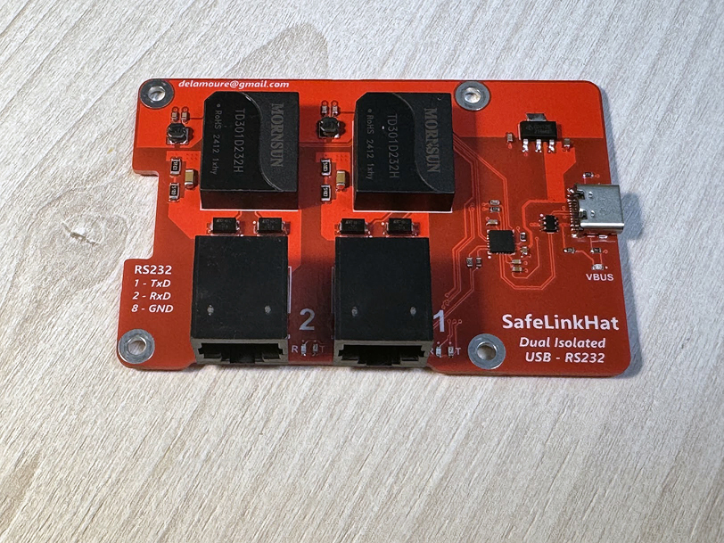
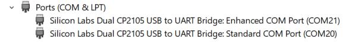
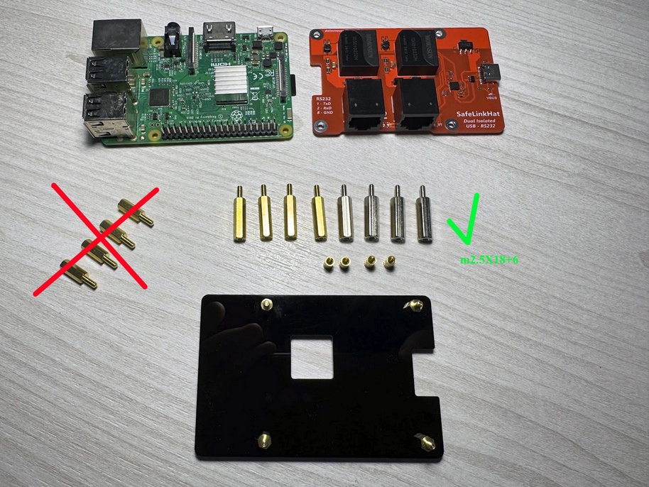
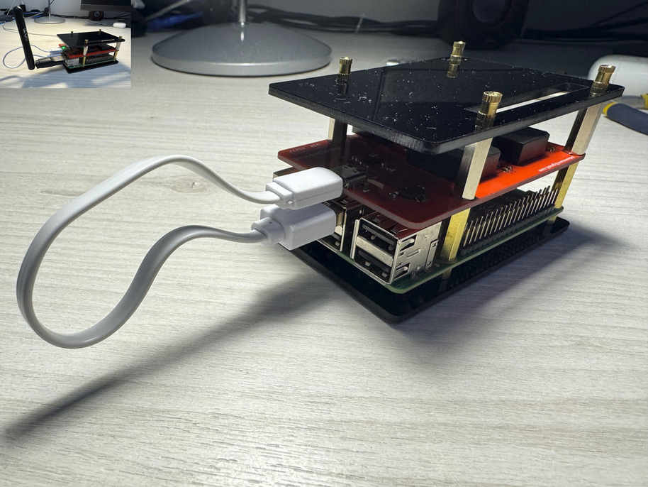
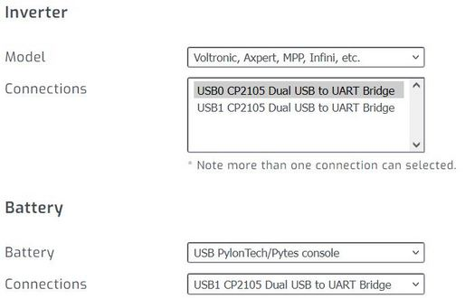
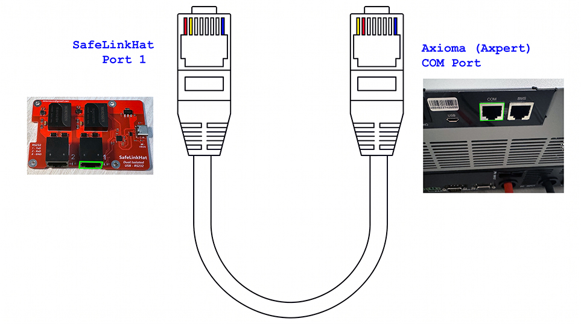
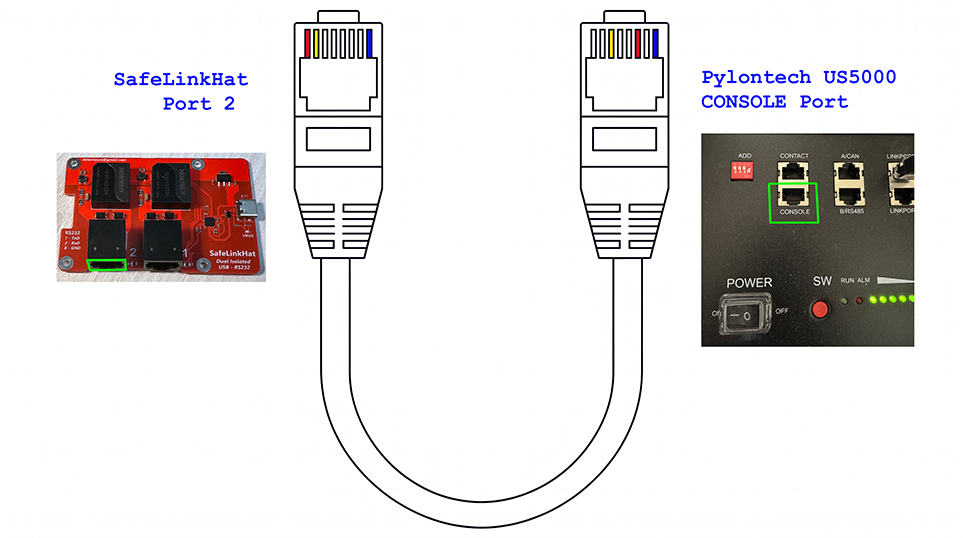
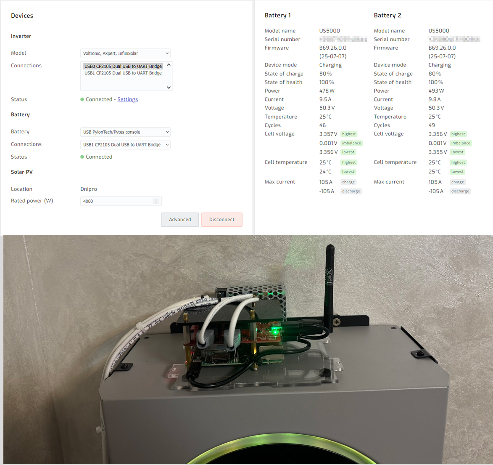
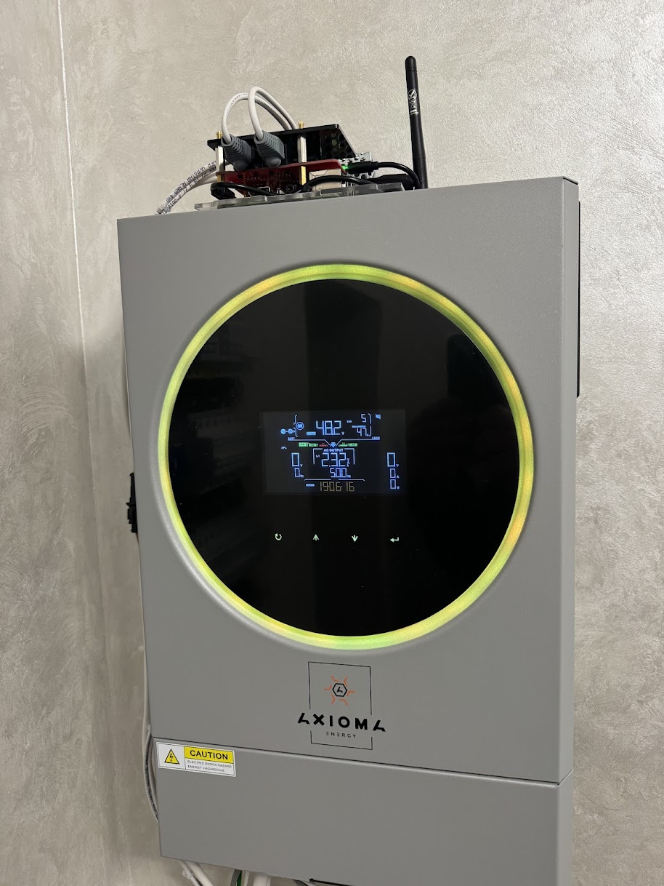
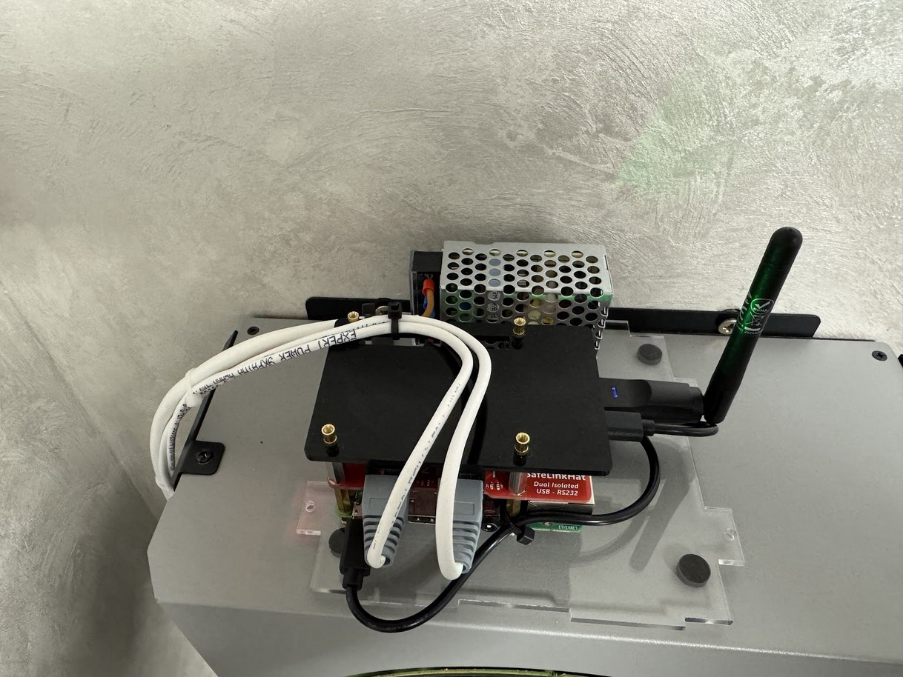

# safe-link-hat

SafeLinkHat is a Raspberry Pi Hat PCB featuring two individually isolated USB-to-RS232 channels. 
It protects the host computer against ground loops, high-voltage spikes, and noise. 
Based on two TD301D232H chips and a CP2105, this project provides a simple and compact solution for isolating RS232 ports.

## Why this project?

While building a home backup power system based on an [Axioma (Axpert)](https://ua.axioma.energy/ru/hibrydnyi-invertor-dbzh-mpp-na-6-kvt-axioma-energy-ismppt-bfp-dou-6000-48v-6000vt) hybrid inverter and [Pylontech US5000 batteries](https://en.pylontech.com.cn/products/us5000), I faced the need for statistics gathering and monitoring. 
Using [Solar-Assistant](https://solar-assistant.io) software on a Raspberry Pi 3 via RS-232 interfaces was the ideal approach. 
However, since most commercial solutions lack galvanic isolation, I designed this straightforward Hat.

## Project content

* [Schematic](Hardware/SafeLinkHat_100.pdf)
* [Production files](Hardware/Production/SafeLinkHat_100_Gerbers_NCdrill.zip)
* [BOM](Hardware/BOM_SafeLinkHat_100.xls)

## Features

- Provides two individually isolated USB-to-RS232 channels
- Fully bus-powered, occupies only one USB port on the Raspberry Pi
- Allows running RS-232 cables significantly longer than any ready-made adapters
- LED status indication for data transmission
- Easy manual soldering, though it requires experience with SMD and QFN packages (automated assembly also possible).
- Low component count (47 parts)

## How to order empty PCBs

You can order them on [jlcpcb.com](https://jlcpcb.com). 
1. Sign in to your account.
2. Click **Order now**.
3. Upload the ZIP archive from the **Production files** section above.
4. Complete the [Online PCB Quote Form](Media/02_jlcpcb.jpg) *(click to view screenshot)*

## How to order parts

The complete list of components is available in the Excel sheet within the **BOM** section above. 
You will also find alternative part options there.

## Post-Assembly Notes

Once the device is assembled, you need to verify its functionality by connecting it to your computer's USB port. 
In Windows Device Manager, you will see two COM ports:

However, that's not all. 
By default, the CP2105 does not control the RX/TX LEDs. 
You will need to activate this functionality as follows (though you can skip this step if you don't need the LED indication).

The required Silicon Labs utility can be downloaded [here](https://www.silabs.com/documents/public/example-code/AN721SW.zip).
I have already prepared the [cp2105_gm.configuration](Software/cp2105_gm.configuration)

For Windows Command Prompt:

Step 1.

`cp210xsmt.exe --device-count 1 --set-config cp2105_gm.configuration`

Step 2. Reconnect the device and run:

`cp210xsmt.exe --device-count 1 --verify-config cp2105_gm.configuration`

## Mount the HAT on the Raspberry Pi

I recommend using an acrylic case for this project.

It will look approximately like this:

## Port Configuration

Start Solar-Assistant, and it will detect two CP2105 ports. Now you are ready for the final step: preparing the connection cables.

## Inverter and Battery Connections

To connect the HAT to your hardware, you need to make two custom RJ45-to-RJ45 cables. The pinout on the SafeLinkHat side uses standard RJ45 connectors.

### 1. SafeLinkHat RJ45 Pinout (Both Channels)

The pin assignment on the HAT's isolated RS-232 ports is as follows:
* **Pin 1:** TX (Transmit)
* **Pin 2:** RX (Receive)
* **Pin 8:** GND (Isolated Ground)

*All other pins are not connected (NC).*

---

### 2. Axioma (Axpert) Inverter Cable

The inverter communication port is typically an RJ45 (labeled as **COM** or **RS232**). 

**Pinout mapping:**
| SafeLinkHat (RJ45) | Inverter COM Port (RJ45) | Signal |
| :---: | :---: | :---: |
| **Pin 1** | Pin 2 | TX → RX |
| **Pin 2** | Pin 1 | RX ← TX |
| **Pin 8** | Pin 8 | GND — GND |

---

### 3. Pylontech US5000 Battery Cable

Connect this cable to the **CONSOLE** port of the master battery (do not use the CONTACT or CAN/RS485 ports). The Pylontech CONSOLE port uses an RJ45 connector.

**Pinout mapping:**
| SafeLinkHat (RJ45) | Pylontech CONSOLE Port (RJ45) | Signal |
| :---: | :---: | :---: |
| **Pin 1** | Pin 6 | TX → RX |
| **Pin 2** | Pin 3 | RX ← TX |
| **Pin 8** | Pin 8 | GND — GND |

> Double-check the connections with a multimeter before plugging the cables into your inverter and battery to prevent damage to the communication ports.

## That's all for now. Thanks for reading!

